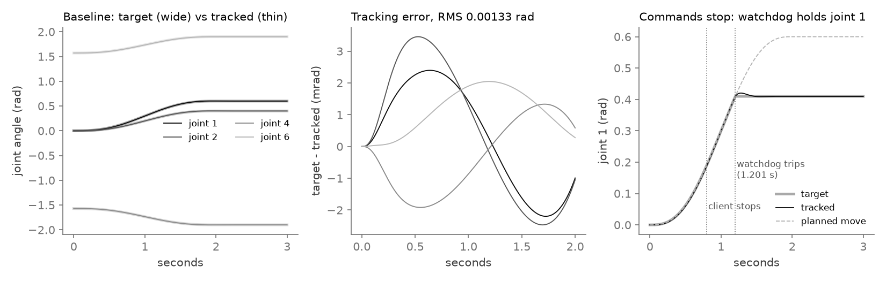
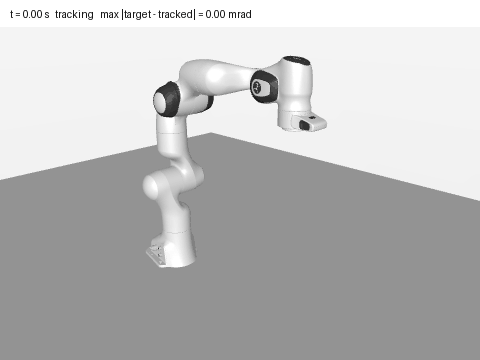
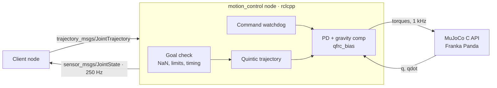

<div align="center">

# ROS 2 C++ Motion Control Stack

**A C++17 ROS 2 node that moves a simulated Franka Panda smoothly, and stops it safely when commands stop.**

Quintic, limit-checked joint trajectories tracked with PD + gravity compensation at 1 kHz through the MuJoCo C API,
a command watchdog, and fault-injection tests that found two real bugs, each with a written root-cause analysis.

[**Project page →**](https://dheepakkaran.github.io/ros2-cpp-motion-control/) · [Results](RESULTS.md) · [RCA-001](docs/rca/RCA-001-resend-reference-jump.md) · [RCA-002](docs/rca/RCA-002-late-stale-stamp-jump.md) · [Build notes](BUILD-LOG.md)


</div>

> **Simulation only.** No real robot or hardware is involved, and nothing is deployed. Independent learning project.

---

## Why this exists

A joint controller that works when every message arrives on time is the easy part. Real command streams get
re-sent, dropped, delayed and sometimes stop entirely. Each of those can make the reference the arm is tracking
jump, and a jump in the reference becomes a torque spike in the motor.

This project builds a small ROS 2 motion control stack and then attacks it on purpose: the same goal re-sent every
100 ms, 30% of messages dropped, messages 300 ms late, one message 5 s stale, the client dying mid-move, and NaN or
over-limit goals. Every fault test asserts that the reference never moves faster than the joint velocity limit.

## Results

| What | Result | Source |
|---|---|---|
| `colcon test-result` | **26 tests, 0 errors, 0 failures** (22 GoogleTest cases + 4 CTest entries) | `results/colcon_test_result.txt` |
| RMS tracking error, 2 s 7-joint move over ROS topics | **0.00132503 rad** (≈ 0.08°) | `results/metrics.json` |
| Final joint error | **6.2e-08 rad** | `results/metrics.json` |
| Control rate | 1 ms physics + control step; **999.8 steps per wall second** | `results/metrics.json` |
| Bad goals (NaN, over-limit) sent over ROS | **2 / 2 rejected**, 0 drift | `results/metrics.json` |
| Bugs found by fault injection | **2**, both fixed → [RCA-001](docs/rca/RCA-001-resend-reference-jump.md), [RCA-002](docs/rca/RCA-002-late-stale-stamp-jump.md) | `results/before-fix/` |

The control rate is soft real time on a normal Linux kernel, not a hard real-time guarantee.

| Fault injected | Before fixes | After fixes |
|---|---|---|
| Baseline: goal re-sent every 100 ms | reference jump 0.165 rad/tick, 3 torque-saturated ticks, RMS 0.0269 rad | jump 0.00056 rad/tick, 0 saturated, RMS 0.00133 rad |
| 30% of messages dropped | same jump bug | 0 watchdog trips, same tracking as baseline |
| Commands stop at 0.8 s | same jump bug | watchdog trips once and holds (drift 0.0123 rad) |
| Messages 300 ms late | jump 0.215 rad, 6 saturated ticks | re-anchored once, jump 0.00056, 0 saturated |
| One message 5 s stale | **0.6 rad step, 167 saturated ticks** | re-anchored once, jump 0.00032, 0 saturated |
| NaN + over-limit goal mid-motion | rejected | rejected, motion finishes normally |

### Demo: target vs tracked, and the watchdog



*Every 1 ms tick of two fault-injection scenarios, logged by the C++ `trajectory_demo` tool (controller core + MuJoCo
C API, no ROS) to `results/demo/trajectory.csv`. Left and middle: the baseline 2 s move; the RMS of 0.00133 rad
matches `results/fault_injection.json`. Right: the client's last command arrives at 0.7 s, the 0.5 s watchdog trips
at 1.201 s and holds joint 1 where it is instead of finishing the move.*



*The same logged baseline joint angles, re-posed in MuJoCo's Python bindings and rendered headless (EGL). Nothing is
simulated again for the picture. Made by `scripts/make_demo_figures.py`.*

## How it works



1. **Trajectories** (`trajectory.hpp`, header-only): quintic segments, so position, velocity and acceleration are continuous. Position range, waypoint velocity, densely sampled peak velocity, NaN/Inf and timing are checked; bad goals are rejected.
2. **Controller core, no ROS** (`controller.hpp`, `watchdog.hpp`): goal handling, PD + gravity/Coriolis compensation from MuJoCo `qfrc_bias`, torque clamp (87 / 12 N·m), and a watchdog that holds the measured position when commands stop.
3. **Simulator** (`src/mujoco_sim.cpp`): Menagerie `panda_nohand.xml`, 1 ms step, model actuators disabled, torques applied through `qfrc_applied`.
4. **ROS 2 node** (`src/motion_control_node.cpp`): subscribes to `joint_trajectory`, publishes `joint_states` at 250 Hz, runs the controller every physics step with sim time locked to wall time by a 1 ms timer.

## Design decisions

| Decision | Why |
|---|---|
| **Controller core has no ROS dependency** | unit and fault-injection tests run it directly against MuJoCo, fast and deterministic; the integration test checks the same behaviour over real topics |
| **Quintic segments** | continuous position, velocity and acceleration, so the reference itself never asks for a torque step |
| **Reject a bad goal, keep the current one** | a NaN or over-limit message mid-move must not stop or derail a valid motion |
| **Watchdog holds the measured position** | holding the last target would pull the arm on toward a goal nobody is sending any more |
| **Re-anchor late or stale goals to now** | a stamp in the past would otherwise make the arm jump to the middle or end of its trajectory (RCA-002) |
| **Reference-jump bound in every fault test** | turns "the arm moved smoothly" into an assertion: at most the velocity limit times 1 ms per tick |
| **pixi + RoboStack** | ROS 2 Jazzy, colcon, compilers and `libmujoco` 3.16 without sudo or a system ROS install, pinned in `pixi.lock` |

## What broke: two real bugs

The first `colcon test` run had **9 failures**, even on the no-fault baseline (`results/before-fix/`).

1. **[RCA-001](docs/rca/RCA-001-resend-reference-jump.md), re-sent goal made the reference jump.** The new trajectory's start *state* came from "now", but its start *time* came from the old message stamp, so every re-send skipped the reference ahead (0.165 rad in one tick, 3 torque-saturated ticks). Fix: evaluate the current plan at the new trajectory's own t = 0.
2. **[RCA-002](docs/rca/RCA-002-late-stale-stamp-jump.md), late or stale stamps made the arm jump.** The controller trusted `header.stamp` as the start; a 5 s stale message stepped joint 1 by 0.6 rad in one tick and saturated torque for 167 ms. Fix: check the reference is continuous at `now`, and if not, re-anchor the move to now (once per stamp).
3. **[RCA-003](docs/rca/RCA-003-faults-handled-by-design.md), faults the design already handled.** Dropped messages, commands stopping and bad goals needed no fix; no bugs were invented for them.

## Run it

Uses [pixi](https://pixi.sh) and [RoboStack](https://robostack.github.io): **no sudo and no system ROS install**.

```bash
pixi install                    # robostack-jazzy + conda-forge env (about 1.5 GB)
scripts/build_and_test.sh       # colcon build + colcon test + test-result
pixi run bash -c 'source install/setup.bash && \
  install/arm_motion_control/lib/arm_motion_control/motion_control_node'

# demo log + figures
pixi run bash -c 'source install/setup.bash && \
  install/arm_motion_control/lib/arm_motion_control/trajectory_demo \
  assets/franka_emika_panda/panda_nohand.xml results/demo/trajectory.csv'
MUJOCO_GL=egl uv run --with mujoco --with matplotlib --with pandas --with pillow python scripts/make_demo_figures.py
```

`scripts/env.sh` caps the build at 2 jobs (`MAKEFLAGS=-j2`) so it fits on low-RAM machines.

| Parameter | Default |
|---|---|
| `model_path` | bundled `assets/franka_emika_panda/panda_nohand.xml` |
| `sim_timestep` | 0.001 s |
| `cmd_timeout` | 0.5 s (0 = off) |
| `kp` / `kd` | 600 ×4, 250, 150, 50 / 50 ×4, 20, 15, 5 |
| `max_torque` | 87 × 4, 12 × 3 N·m (Panda datasheet) |
| `max_velocity` | 2.175 × 4, 2.61 × 3 rad/s (Panda datasheet) |
| `publish_every_n_steps` | 4 (→ 250 Hz `joint_states`) |
| `max_catchup_steps` | 20 |

**Goal protocol:** a client re-sends the same `JointTrajectory` (same `header.stamp`) while it runs, to feed the
watchdog; a zero stamp means "start now"; late stamps are re-anchored to now (RCA-002).

## Repo map

| Path | What |
|---|---|
| `include/arm_motion_control/` | trajectory, watchdog, controller, sim and node headers |
| `src/` | MuJoCo wrapper, ROS 2 node, `main` |
| `test/` | GoogleTest: `test_trajectory` (8), `test_watchdog` (5), `test_fault_injection` (6), `test_integration` (3) |
| `tools/trajectory_demo.cpp` | logs every tick of two fault scenarios to CSV |
| `scripts/` | `build_and_test.sh`, `env.sh`, `make_demo_figures.py` |
| `docs/rca/` | root-cause analyses |
| `results/` | metrics, fault-injection JSON, colcon + gtest logs (before and after the fixes), demo CSV |
| `assets/franka_emika_panda/` | Menagerie Panda model (Apache-2.0) |
| `pixi.toml` · `pixi.lock` | reproducible ROS 2 + MuJoCo environment |
| `docs/index.html` | the project page (GitHub Pages) |

## Limits

- **Integration test in one process:** both nodes run with a multi-threaded executor and talk over real ROS topics; there is no `launch_testing` or `ros2` CLI demo (`ros2cli` is not in the env).
- **Watchdog contract:** the client must re-send faster than `cmd_timeout`.
- **Stale goals are re-anchored and run late, not refused**; there is no max-latency parameter.
- **Soft real time** on a normal kernel; no RT guarantee.
- **Not done:** Docker image, CI, a Cartesian move service.

## Next

CI and a Dockerfile · a launch-file demo with `ros2cli` · a max-latency reject option · jerk logging · inertia feed-forward.

## Credits

Franka Emika Panda model from [MuJoCo Menagerie](https://github.com/google-deepmind/mujoco_menagerie) (Apache-2.0, `assets/franka_emika_panda/LICENSE`).
Author: Dheepak Karan Elumalai Santhakumari.
